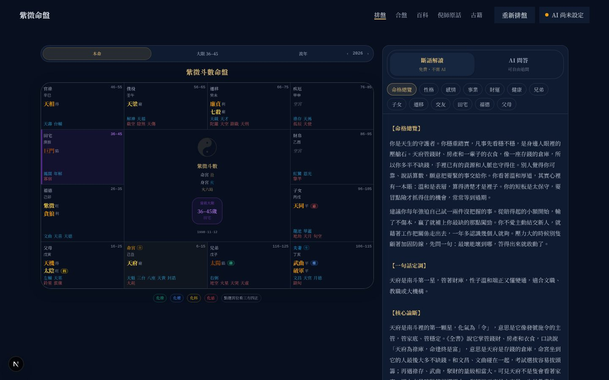

# 紫微斗數 · 繁體中文開源版

依倪海廈《天紀》體系排盤的紫微斗數網站。**全繁體中文（台灣用語）、免費、開源，裝在你自己的電腦上。**

- 排完盤就有 **13 個面向的完整斷語**（67.5 萬張命盤的開源解讀數據集），**不需要 AI**
- 想深入追問，可以自己選擇串接 **ChatGPT、Claude、Gemini、DeepSeek**，或免費的 **Ollama 本機模型**
- 支援**台灣夏令時間**（1945–1979）與 **368 個鄉鎮市區**的真太陽時校正；海外 28 國 105 個城市自動換算時區與當地夏令時間
- 附**倪師《天紀》原話 1,848 條**（可搜尋，每條都能跳回原影片時間點）與古籍節錄

改作自開源專案 [Renhuai123/ziwei-doushu](https://github.com/Renhuai123/ziwei-doushu)（作者：王多魚AI）。繁體改作：賀少穎（imsky.tw）。

## 內容有多大

| 內容 | 數量 | 大小 |
|---|---|---|
| **命盤斷語**（開源解讀數據集 v4.0） | **674,976 張命盤**：國曆 1950–2026 年每一個真實日期 × 12 個時辰 × 男女 | 每張盤 13 個面向，共 **8,774,688 段解讀**、正文約 **204 億字**（原作者統計），平均每張盤約 3 萬字；解壓後 **56.6 GB**，壓縮後 161 MB（77 個年份檔） |
| **倪師《天紀》原話** | **1,848 條**，涵蓋紫微斗數 14 講與 2 段補充 | 每條附原影片時間點 |
| **古籍** | 骨髓賦、《紫微斗數全集》《全書》共 **75 段**重點節錄 | 可全文搜尋 |
| **出生地** | 台灣 **22 縣市、368 鄉鎮市區**；海外 **28 國、105 個城市**（自動換算當年時區與夏令時間）；另含港澳與中國大陸城市 | 用於真太陽時校正 |
| **台灣夏令時間** | 1945–1979 年共 **20 個年度**的實施期間，加上 1937–1945 日治時期 | 與國際時區資料庫逐日比對 22,280 天 |

> 這 56.6 GB 的斷語**不放在這個 GitHub 專案裡**（專案本身只有約 8 MB）。使用者排到哪一年出生的盤，程式才從原作者的 GitHub 下載那一年的檔案（約 2 MB），用官方 SHA-256 驗證後存在自己電腦裡，之後秒開。




---

## 目錄

1. [三種安裝方式，選一種就好](#一三種安裝方式選一種就好)
2. [Mac 安裝教學](#二mac-安裝教學)
3. [Windows 安裝教學](#三windows-安裝教學)
4. [選擇要串接的 AI](#四選擇要串接的-ai)
5. [功能說明](#五功能說明)
6. [常見問題](#六常見問題)
7. [進階：指令、公開架設、同步原版](#七進階指令公開架設同步原版)
8. [授權與來源標註](#八授權與來源標註)

---

## 一、三種安裝方式，選一種就好

> 📘 **完整圖文步驟**：[Mac 安裝與使用教學](docs/安裝與使用教學-Mac.md)、[Windows 安裝與使用教學](docs/安裝與使用教學-Windows.md)。從準備工作、每一步會看到什麼、各家 AI 金鑰怎麼申請、網站怎麼用，到疑難排解都有。下面是精簡版。

| 方式 | 適合誰 | 怎麼做 |
|---|---|---|
| **A. 一行指令** | 最快，會開終端機就行 | Mac 貼到「終端機」、Windows 貼到「PowerShell」，見下方 |
| **B. 交給 AI 裝** | 有 Claude 桌面版、Codex、Cursor 這類能操作電腦的 AI | 把 [AI 安裝提示詞](docs/AI安裝提示詞.md) 整段貼給它 |
| **C. 下載後雙擊** | 不想碰指令 | 下載 ZIP → 解壓縮 → 雙擊啟動檔 |

**一行指令**

Mac（打開「終端機」貼上，按 Enter）：

```bash
curl -fsSL https://raw.githubusercontent.com/imskytw/ziwei-tw/main/install.sh | bash
```

Windows（按開始鍵、輸入 PowerShell 打開，貼上，按 Enter）：

```powershell
irm https://raw.githubusercontent.com/imskytw/ziwei-tw/main/install.ps1 | iex
```

指令會自動：檢查並安裝 Node.js → 下載專案到使用者資料夾裡的 `ziwei-tw` → 啟動並打開瀏覽器。第一次會跳出 AI 設定精靈（可以直接按 Enter 跳過）。再執行一次同一行指令就是**更新**，你的設定和已下載的斷語會保留。

---

## 二、Mac 安裝教學

### 步驟 1：安裝 Node.js

1. 打開 <https://nodejs.org/zh-tw/download>，下載 **LTS** 版的 macOS 安裝檔（.pkg）
2. 雙擊安裝，一路按「繼續」。版本需要 **22.15 以上**

> 已經裝過的話：按 `⌘ + 空白鍵` 搜尋「終端機」打開，輸入 `node -v`，顯示 v22.15 以上就不用重裝。

### 步驟 2：下載專案

在本專案 GitHub 頁面按綠色的 **Code → Download ZIP**，下載後雙擊解壓縮，把資料夾放到你習慣的位置（例如「文件」）。

### 步驟 3：雙擊啟動

打開資料夾，雙擊 **`啟動紫微斗數.command`**。

- 第一次會安裝套件（1–3 分鐘，畫面跑很多字是正常的），接著出現 AI 設定精靈
- 完成後會自動打開瀏覽器，網址通常是 <http://localhost:3456>

> **出現「無法打開，因為它來自未識別的開發者」？** 對檔案按右鍵 → **打開** → 再按一次「打開」。之後就能直接雙擊。

> ⚠️ 使用期間**不要關閉終端機視窗**，關掉網站就停了。

### 之後每次使用

雙擊 `啟動紫微斗數.command`。要換 AI，雙擊 `設定AI.command`。

---

## 三、Windows 安裝教學

### 步驟 1：安裝 Node.js

1. 打開 <https://nodejs.org/zh-tw/download>，下載 **LTS** 版的 Windows 安裝檔（.msi）
2. 雙擊安裝，一路按「Next」，版本需要 **22.15 以上**
3. 安裝畫面若出現「Automatically install the necessary tools」的勾選框，**不用勾**

> 檢查方式：按開始鍵輸入 `cmd` 打開「命令提示字元」，輸入 `node -v`，顯示 v22.15 以上即可。

### 步驟 2：下載專案

在本專案 GitHub 頁面按 **Code → Download ZIP**。下載後**對 ZIP 按右鍵 → 全部解壓縮**（不要直接在壓縮檔裡面執行），放到例如「文件」資料夾。

### 步驟 3：雙擊啟動

打開資料夾，雙擊 **`啟動紫微斗數.bat`**。

- 第一次會安裝套件並出現 AI 設定精靈，完成後自動打開瀏覽器
- **出現藍色的「Windows 已保護您的電腦」**：按「其他資訊」→「仍要執行」
- **防火牆詢問是否允許 Node.js 存取網路**：選「允許」（只在你自己的電腦上使用，勾「私人網路」即可）

> ⚠️ 使用期間**不要關閉黑色的命令視窗**，關掉網站就停了。

### 之後每次使用

雙擊 `啟動紫微斗數.bat`（用一行指令安裝的話，桌面上會有「紫微斗數」捷徑）。要換 AI，雙擊 `設定AI.bat`。

### Windows 常見狀況

| 狀況 | 怎麼處理 |
|---|---|
| 雙擊 .bat 閃一下就關掉 | 代表還沒裝好 Node.js，回到步驟 1；裝完後**重新開機**再試 |
| PowerShell 說「無法載入，因為這個系統上已停用指令碼執行」 | 一行指令用的是 `irm … \| iex`，不受這個限制；若你是直接執行 .ps1 檔，改用一行指令 |
| 中文顯示成亂碼 | 不影響網站本身，可以忽略 |
| winget 找不到 | 較舊的 Windows 10 沒有 winget，請照步驟 1 手動安裝 Node.js |

---

## 四、選擇要串接的 AI

排盤和斷語解讀都**不需要 AI**。AI 只用在「AI 問答」（自由追問）和「合盤分析」。

| 編號 | 選項 | 去哪裡拿金鑰 | 特點 |
|---|---|---|---|
| 1 | ChatGPT（OpenAI） | <https://platform.openai.com/api-keys> | 最多人用 |
| 2 | Claude（Anthropic） | <https://console.anthropic.com/settings/keys> | 長篇解讀條理清楚 |
| 3 | Gemini（Google） | <https://aistudio.google.com/apikey> | 通常有免費額度，適合試用 |
| 4 | DeepSeek | <https://platform.deepseek.com/api_keys> | 價格便宜 |
| 5 | Ollama 本機模型 | 不需要金鑰，先裝 <https://ollama.com/download> | 免費，資料不離開電腦，需要電腦效能夠好 |
| 6 | 其他 OpenAI 相容服務 | 依該服務 | 自行填網址與模型名稱 |

> 💡 「API 金鑰」和你平常訂閱的 ChatGPT Plus、Claude Pro **分開計費**。

設定精靈會問你編號、請你貼上金鑰（畫面只顯示 •）、模型名稱（直接 Enter 用預設）、網站名稱。設定存在專案資料夾的 `.env.local`，**這個檔案裡有金鑰，不要分享或上傳**（專案已設定不會上傳到 GitHub）。

**預設模型**（2026 年 11 月；之後若顯示「找不到模型」，用「設定AI」改成新名稱即可）

| AI | 預設模型 |
|---|---|
| ChatGPT | `gpt-6.1-sol` |
| Claude | `claude-sonnet-5-5` |
| Gemini | `gemini-3.8-flash` |
| DeepSeek | `deepseek-chat` |
| Ollama | `qwen3`（先在終端機執行 `ollama pull qwen3`） |

排盤頁右上角會顯示目前串接的 AI：綠燈＝已設定好，黃燈＝還沒設定。

---

## 五、功能說明

**排盤**：十四主星、輔星煞星、四化、廟旺利陷亮度、十二神煞、大限與流年。出生地選到鄉鎮市區，系統會用經度校正真太陽時。

**台灣夏令時間**：出生日期落在 1945–1961、1974–1975、1979 年的夏令時間，或 1937–1945 年日治時期（當時用日本標準時），表單會提醒你，並提供可復原的「減 1 小時」按鈕。資料依中央氣象署公告，並與國際時區資料庫逐日比對。

**斷語解讀（不用 AI）**：依出生日期、時辰、性別，從開源解讀數據集查出 13 個面向（命格、性格、感情、事業、財運、健康、兄弟、子女、遷移、交友、田宅、福德、父母），每張盤約三萬字。只涵蓋國曆 1950–2026 年出生的命盤。第一次查某一年需要連網下載約 2 MB（會用官方 SHA-256 驗證），之後存在電腦裡，秒開。

**AI 問答與合盤**：把命盤整理成文字交給你選的 AI，依倪師體系解讀，可以自由追問。

**倪師原話**：倪海廈《天紀》課程中講紫微斗數的原話 1,848 條，依主星、宮位、四化、格局、看盤方法分類，可搜尋，每條附影片時間點。**百科**頁也是以這些原話分類整理。

**古籍**：骨髓賦、《紫微斗數全集》《紫微斗數全書》的重點段落（**節錄，非全文**），可全文搜尋。

**和原專案的差別**

| | 原專案 | 本繁體版 |
|---|---|---|
| 語言 | 簡體中文 | 繁體中文（台灣用語），排盤庫也改用繁體輸出，並修正 OpenCC 轉錯的命理用字（斗、干、對象等） |
| 解讀 | 斷語庫未開源 | 接上開源解讀數據集，不用 AI 就有 13 面向解讀 |
| AI 解讀、合盤 | 未開源 | 已內建，可選 6 種 AI |
| 百科 | 詳細頁內容未開源（空白） | 改以倪師原話分類整理 |
| 夏令時間 | 只有中國大陸 | 加上台灣與日治時期 |
| 出生地 | 以大陸城市為主 | 台灣 22 縣市、368 鄉鎮市區，加上海外 28 國 105 個城市 |
| 介面 | — | 全面改版，修正原本格線不顯示、亮色模式看不清等問題，移除原站公告與流量追蹤 |

> 轉成繁體後，以 1,500 張隨機命盤逐欄比對簡體原版與繁體版的排盤與格局結果（6,525 個格局），完全一致；原專案的回歸測試全部通過。

---

## 六、常見問題

**網頁顯示「無法連上這個網站」**：網站沒有在執行。確認終端機（Windows 是黑色命令視窗）還開著；關掉了就重新雙擊啟動檔。

**打開 localhost 看到別的網站**：你的電腦有其他程式佔用了那個埠，啟動程式會自動換一個（例如 3457），**以終端機上顯示的網址為準**。

**AI 解讀出現錯誤訊息**

| 訊息 | 處理方式 |
|---|---|
| 尚未設定金鑰 | 執行「設定AI」填入金鑰，再重新啟動 |
| 金鑰不正確或沒有權限 | 金鑰複製錯了或已刪除，重新建立一把 |
| 用量超過上限或餘額不足 | 到該服務帳戶頁儲值，或換一家 |
| 找不到模型 | 用「設定AI」改成最新的模型名稱 |
| 連不上 Ollama | 確認 Ollama 已開啟（或在終端機執行 `ollama serve`） |

**斷語解讀顯示「下載失敗」**：第一次查某一年需要連網。確認網路後重新整理頁面。

**要不要按「減 1 小時」？** 出生證明或家人記得的時間，通常是當時的鐘錶時間，要減。如果已經自己換算過就不要按。按錯可以按「復原」。

**海外出生怎麼填？** 出生地選「海外」裡的國家和城市，填當地鐘錶時間就好，時差與當年的夏令時間會自動換算。清單裡沒有的城市，選同一個時區裡最近的城市。

**怎麼關掉？** 關掉終端機視窗即可。

**怎麼更新？** 重新執行一次一行安裝指令；或重新下載 ZIP，把舊資料夾的 `.env.local` 和 `data` 資料夾複製過去。

---

## 七、進階：指令、公開架設、同步原版

```bash
npm install          # 安裝套件（需要 Node.js 22.15 以上）
npm run setup        # AI 設定精靈
npm run dev          # 開發模式（http://localhost:3000）
npm run build && npm start   # 正式模式
npm run typecheck    # 型別檢查
npm test             # 排盤回歸測試（含台灣夏令時逐日比對）
```

**公開架設**（例如 Vercel）：在環境變數填入 `AI_PROVIDER`、對應金鑰、`NEXT_PUBLIC_SITE_NAME`、`NEXT_PUBLIC_SITE_URL`。

> ⚠️ 公開架設後，**任何人用 AI 解讀花的都是你的金鑰額度**，本版沒有登入與用量限制。建議在 AI 服務後台設定每月上限。斷語數據集會下載到伺服器的 `data/` 資料夾，需要可寫入的磁碟（Vercel 這類無狀態主機每次冷啟動都要重新下載）。

**同步原專案的更新**：原專案會持續更新排盤引擎。把新版簡體檔案放進來後執行

```bash
python3 scripts/sync-upstream/convert-to-tw.py <資料夾>
```

它會轉成繁體並套用命理用字修正（`zh_fix.py`），之後把 `lib/ziwei/algorithm.ts` 的 iztro 語系確認為 `zh-TW`，再跑 `npm test`。

**專案結構**

| 路徑 | 內容 |
|---|---|
| `lib/ziwei/` | 排盤引擎（原專案，已轉繁體） |
| `lib/ziwei/dst-tw.ts` | 台灣夏令時間與日治時期時區 |
| `lib/ziwei/cities.ts` | 出生地經度（台灣 368 鄉鎮由 `scripts/gen-taiwan-towns.js` 從內政部圖資產生） |
| `lib/interp/` | 解讀數據集：按年下載、驗證、解壓、轉繁體、快取 |
| `lib/llm/` | AI 串接：`providers.ts`（各家設定與串流）、`chart-text.ts`（命盤轉文字）、`prompts.ts`（系統提示詞） |
| `lib/tianji/` | 倪師原話 1,848 條（繁體） |
| `lib/zh-fix.ts`、`scripts/sync-upstream/` | 繁簡轉換與命理用字修正 |
| `app/api/` | `interpret`（AI 解讀）、`heming`（AI 合盤）、`reading`（斷語查詢）、`llm-status` |
| `app/editorial.css` | 設計系統（色彩、字級、版面） |
| `scripts/setup.mjs`、`scripts/launch.mjs` | 設定精靈、一鍵啟動 |
| `install.sh`、`install.ps1` | 一行安裝指令 |

想調整 AI 的解讀風格，改 `lib/llm/prompts.ts`。

---

## 八、授權與來源標註

本專案包含幾種授權不同的內容，使用或再散布時請分別遵守：

| 內容 | 授權 | 要求 |
|---|---|---|
| 程式碼 | [MIT](LICENSE) | 保留著作權聲明（原專案 + 繁體改作） |
| 解讀數據集 v4.0（執行時從原專案下載） | CC BY 4.0 | 標註：紫微斗數開源解讀數據集 v4.0，來源 https://github.com/Renhuai123/ziwei-doushu ，作者王多魚AI |
| 倪師原話（`lib/tianji/`、`docs/tianji-ziwei/`） | **CC BY-NC-SA 4.0** | **不可商用**；改作須用相同授權；原課程著作權屬倪海廈先生及其權利繼承人 |
| 古籍原文 | 公有領域 | — |
| 網站圖片（蘇州石刻天文圖、敦煌星圖、《本草綱目》初刻本） | 公有領域／CC0／CC BY 4.0 | 頁尾已標註，見 `docs/credits/images.json` |
| 標題字型：王漢宗中行書繁（`public/fonts/`，已縮減字數） | GNU GPL v2 以上 | 免費；王漢宗教授捐出，再散布須附授權全文（`public/fonts/LICENSE-wanghanzong-GPL-2.0.txt`） |
| 內文字型：芫荽 Iansui（手寫楷書，台灣教育部標準字形，由 Google Fonts 載入） | SIL Open Font License 1.1 | 免費、可商用；作者 But Ko，https://github.com/ButTaiwan/iansui |

- 網站頁尾已放上來源標註，**改作或公開架設時請保留**。
- 因為含有不可商用的倪師原話，**整個網站請勿拿來收費**；若要商用，須先移除 `lib/tianji/`、`docs/tianji-ziwei/` 與相關頁面。
- 倪海廈先生本人與本專案無任何關聯。所有命理內容僅供文化研究與自我探索參考，不構成醫療、投資、法律或重大決策建議。
